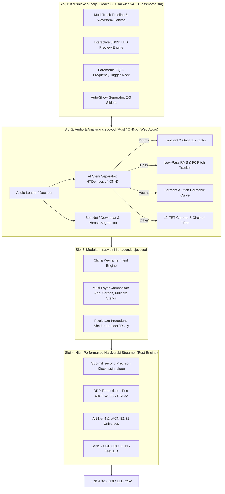

# LEDicated – Tehnički pregled istraživanja i arhitektura sustava (Faza 1)

Ovaj dokument sadrži cjelokupnu sintezu Faze 1 istraživanja: detaljnu analizu svih vodećih open-source i komercijalnih rješenja za kontrolu LED rasvjete, audio analizu, AI separaciju stemova, matematičke modele blendanja slojeva i arhitekturu profesionalnog DAW sučelja u stilu Apple Glassmorphisma.

---

## 1. Pregled i usporedba postojećih softverskih rješenja

### 1.1 Open-Source sustavi za LED kontrolu i sekvenciranje

| Sustav | Tehnološki stog | Primarni fokus | Obrada zvuka | Protokoli | Što preuzimamo za LEDicated |
| :--- | :--- | :--- | :--- | :--- | :--- |
| **xLights (Nutcracker)** | C++ / wxWidgets / OpenGL | Offline timeline sekvencer za mega-displeje | Vamp Plugins (QM Beat Tracker, Onsets, Pitch) | E1.31 (sACN), Art-Net, DDP, FPP MultiSync, `.fseq` | Model slojeva i blend modova (do 200 slojeva), frame caching sustav |
| **LedFx** | Python 3 / AsyncIO / NumPy / Web UI | Real-time audio reaktivni kontroler za sobe/klubove | Live FFT, Mel filterbank (12–64 bandova), dynamic AGC, Aubio | WLED UDP, DDP, E1.31, Art-Net, WebSockets | Vektorski DSP cjevovod za live zvuk, audio-reaktivni algoritmi za 2D matrice |
| **WLED** | C++ / ESP-IDF / Arduino | Firmware za mikrokontrolere (ESP32) | AudioReactive usermod (I2S mikrofon $\rightarrow$ 512-pt FFT $\rightarrow$ 16/32 GEQ) | WLED UDP (DRGB/WARLS), DDP (Port 4048), E1.31 | Defaultni protokol za komunikaciju s hardverom (DDP / UDP stream) |
| **Pixelblaze** | C++ (VM) / JS Bytecode | Proceduralni shaderski engine za LED-ove | Senzorski board (32-bin FFT, pitch, energija) | WebSockets, UDP sync | Normalizirane koordinate $(x, y, z \in [0.0, 1.0])$ za proceduralne efekte |
| **Jinx!** | C / Win32 | VJ mixer za LED matrice | Real-time FFT spektar i envelope follower | Art-Net, sACN, tpm2.net | Dual-deck VJ crossfader i 12 matematičkih načina stapanja matrica |
| **Vixen Lights** | C# / .NET / WPF | Parametrijski timeline sekvencer | Uvoz Audacity oznaka, osnovni beat markeri | E1.31, DDP, Art-Net | *Intent-based* podatkovni model (kontinuirane Bezier krivulje umjesto fiksnih frameova) |
| **Falcon Player (FPP)** | C++ / Linux daemon | Dedicated player za RPi / BeagleBone | Sinkronizacija audio zapisa | MultiSync UDP (32320), DDP, E1.31 | Format zaglavlja i streaming kompresija |
| **Hyperion.ng** | C++ / Qt | Ambient bias lighting | Skriptabilni JSON/Python | FlatBuffers, Protobuf, UDP | Priority Channel Queue (0–255) za live override događaje |
| **QLC+** | C++ / Qt | Kazališni DMX pult | Sound-to-light peak trigger | DMX512, Art-Net, sACN, MIDI, OSC | HTP (Highest Takes Precedence) i LTP pravila za DMX rasvjetna tijela |
| **OpenRGB** | C++ / Qt | SDK za računalne RGB periferije | Nema (klijentski pogon) | OpenRGB TCP (6742) | Mogućnost kontrole PC periferija unutar istog light showa |

---

### 1.2 Komercijalni VJ, Stage i DAW-to-Light sustavi

* **SoundSwitch (InMusic / Denon / Serato / Engine DJ):**
  * *Ključni mehanizam:* Čita Beatgrid metapodatke iz DJ softvera i analizira energetsku strukturu pjesme (Intro, Verse, Build-up, Pre-Drop, Drop, Breakdown, Outro).
  * *AutoScripting:* Automatski raspoređuje rasvjetne uloge (Wash, Spot, Strobe, Blinder). Na dropu aktivira stroboskope na bas-dobošu, dok na build-upu ubrzava LFO frekvenciju ($1/2 \to 1/4 \to 1/8 \to 1/16$).
* **Beam by Showsync (Ableton Live ekosustav):**
  * *Decoupled arhitektura:* UI i uređaji žive kao Max for Live komponente u Abletonu, dok high-performance pozadinski proces (Beam Engine daemon) šalje DMX/Art-Net pakete na frekvencijama do 1000 Hz bez utjecaja na audio buffer.
  * *Tag-based mapiranje:* Rasvjetna tijela se adresiraju putem tagova (npr. `#matrix_3x3`, `#led_strip_desk`) umjesto fiksnih DMX kanala, što omogućuje prenosivost projekata.
* **TouchDesigner (Derivative) & Resolume Arena / Wire:**
  * *Slikovni i čvorni cjevovod:* Zvuk se pretvara u numeričke CHOP kanale, zatim u TOP teksture (RGB piksele), a fixture layouti sempliraju boje s 2D površine uz automatsko dijeljenje univerzuma (Auto-Span).
* **Lightkey (macOS Native):**
  * Vrhunski primjer Apple estetike: Cocoa / Metal sučelje, tamni način rada, 2D fotorealistični prikaz snopova i rasvjete, fluidne animacije.
* **GrandMA3 onPC:**
  * MAtricks i Phaser motor: matematičke cikličke fazne krivulje raspoređene po $X, Y, Z$ prostornoj matrici uređaja.

---

## 2. Gap analiza: Što nedostaje postojećim sustavima?

1. **Nijedan postojeći sustav ne koristi separaciju stemova za kontrolu rasvjete:**
   * Sustavi poput LedFx-a ili WLED-a rade na master miksu gdje se frekvencije preklapaju (npr. vokal i synth u mid-bandu se sudaraju s gornjim harmonicima basa).
   * Sustavi poput xLightsa ili Vixena zahtijevaju stotine sati ručnog crtanja efekata na timelineu.
2. **Razdvojenost live performansa i preciznog sekvenciranja:**
   * VJ alati (Resolume, TouchDesigner) fokusirani su na live video matricu, a ne na intuitivno programiranje pjesama po mjeri kućnog/uredskog studija.
   * xLights je statičan (baking u frameove), a WLED nema višestazni timeline editor.
3. **Zastarjeli UI/UX:** Većina open-source alata koristi stare C++/Qt ili wxWidgets frameworke bez fluidnosti modernih DAW programa (FL Studio, Ableton, Bitwig).

---

## 3. Arhitektura sustava LEDicated



---

## 4. Tehnološki stog

* **Aplikacijski okvir:** **Tauri v2** (Rust jezgra + Webview frontend).
  * *Prednosti:* Izvorna macOS prozirnost (`NSVisualEffectView` vibrancy), jitter ispod $0.5\text{ ms}$, memorijski otisak od samo $30–70\text{ MB}$, direktni UDP socketi bez Node.js uskih grla.
* **Korisničko sučelje:** **React 19 + TypeScript + Tailwind CSS v4 + Radix UI + Lucide Icons**.
* **Timeline Engine:** **Četveroslojni HTML5 Canvas 2D** s LoD piramidom vrhova (Peak Pyramid) za trenutno skrabanje bez zastoja.
* **LED Visualizer:** **WebGL2 / PixiJS v8 / Three.js** s prilagođenim shaderom za simulaciju fizičke LED diode, radijalne difuzije, akrilnog raspršenja i blooma.
* **AI Stem Separacija:** **HTDemucs v4** pogonjen putem `demucs-onnx` / `stem-splitter-core` (CoreML/Metal akceleracija na Apple Siliconu).
* **Hardverski protokoli:**
  * **DDP (Distributed Display Protocol):** Primarni protokol (port 4048) – prenosi do 480 RGB LED-ova po UDP paketu bez fragmentacije univerzuma.
  * **WLED UDP Realtime:** Port 21324 (`DRGB` način rada).
  * **Art-Net v4 & sACN (ANSI E1.31):** Podrška za standardne DMX uređaje.

---

## 5. Audio analitički cjevovod i mapiranje stemova

```
┌────────────────────────────────────────────────────────────────────────────────────────┐
│ STEM SEPARACIJA & PARAMETRIJSKO MAPIRANJE                                              │
├───────────────┬───────────────────────────────┬────────────────────────────────────────┤
│ Stem          │ Izdvojene audio značajke       │ Ponašanje na LEDicama (Vizualni efekt) │
├───────────────┼───────────────────────────────┼────────────────────────────────────────┤
│ 🥁 DRUMS      │ Transienti, kick sub-udarci,   │ - Oštri bijeli stroboskopski akcenti  │
│               │ snare noise, hi-hat činele    │ - Radijalni udarni valovi (iz centra)  │
│               │ (Attack: 0-2ms, Decay: 60ms)  │ - Reakcija vanjskog okvira / rubova    │
├───────────────┼───────────────────────────────┼────────────────────────────────────────┤
│ 🎸 BASS       │ Sub-bass RMS omotnica,        │ - Pozadinski ambijentalni room glow    │
│               │ osnovna frekvencija F0        │ - Vertikalni stupac (VU fill height)   │
│               │ (Attack: 20ms, Decay: 350ms)  │ - Modulacija nijanse (Ljubičasta->Plava)│
├───────────────┼───────────────────────────────┼────────────────────────────────────────┤
│ 🎤 VOCALS     │ Formanti (500Hz-4kHz),        │ - Osvjetljenje središnje 3x3 matrice   │
│               │ pitch krivulja, RMS glasnoća  │ - Fluidni sinusni valovi i disanje     │
│               │ (Attack: 50ms, Decay: 600ms)  │ - Organsko pulsiranje svjetline        │
├───────────────┼───────────────────────────────┼────────────────────────────────────────┤
│ 🎹 OTHER      │ 12-TET kromatogram, akordi,   │ - Paleta boja prema Krugu kvinti       │
│   (Synths/    │ visokosrednji harmonici       │ - Komete i putujuće čestice po traci   │
│    Guitars)   │ (Attack: 30ms, Decay: 250ms)  │ - Prožimajuće teksture i arpeggia      │
└───────────────┴───────────────────────────────┴────────────────────────────────────────┘
```

### 5.1 Matematički model blendanja slojeva

Svaki piksel $p(x,y)$ na matrici izračunava se stapanjem slojeva odozdo prema gore:

1. **Additive (Linearno zbrajanje):** $C_{out} = \min(1.0, C_a + C_b)$ – koristi se za stroboskop bubnja preko ambijentalnog vokala.
2. **Screen:** $C_{out} = 1.0 - (1.0 - C_a) \cdot (1.0 - C_b)$ – sprječava izgaranje u bijelo pri jakom preklapanju više instrumenata.
3. **Multiply (Maskiranje):** $C_{out} = C_a \cdot C_b$ – ritam bubnja stvara modulacijsku masku preko harmonične melodije.
4. **Luminance Stencil Mask:** $C_{out} = C_b \cdot \text{Luminance}(C_a)$ – efekt B prikazuje se isključivo unutar siluete efekta A.
5. **HTP (Highest Takes Precedence):** $C_{out} = \max(C_a, C_b)$ – kazališno pravilo za kanale intenziteta.

---

## 6. Dizajn sučelja (Apple Glassmorphism + FL Studio / Ableton)

* **Paleta boja:**
  * Pozadina: Duboka opsidijan crna (`#0B0C10` i `#12131A`).
  * Paneli: Akrilno zamućeno staklo `rgba(22, 24, 34, 0.72)` uz `backdrop-filter: blur(24px) saturate(180%)`.
  * Neonski akcenti: Smaragdno zelena (`#00FFA3`), Električni cijan (`#00E5FF`), Žarki magenta (`#FF0055`), Zlatni amber (`#FFB300`).
* **Struktura sučelja:**
  1. **Gornja traka (Transport & Clock):** BPM, Play/Pause, Loop, Timecode (SMPTE), Master Dimmer, DDP status konekcije s uredskim kontrolerom.
  2. **Glavni Timeline (Lijeva / Središnja sekcija):** Višestazni prikaz s višekanalnim spektralnim RGB waveformom (Crveno = Bas, Zeleno = Srednji, Plavo = Visoki), trakama za pojedine stemove i rasvjetna tijela, te Bezier krivuljama automatizacije.
  3. **3D/2D LED Stage Preview (Desna sekcija):** Interaktivna simulacija 3x3 uredske matrice i LED traka u stvarnom vremenu (60+ FPS) sa shaderom za difuziju i svjetlosni sjaj.
  4. **Donji Modularni Dok (Inspector):**
     * **Parametric EQ:** Interaktivni logaritamski spektrogram ($20\text{ Hz} - 20\text{ kHz}$) s povlačenjem točaka i definiranjem okidača animacije.
     * **Preset & FX Browser:** Gotove proceduralne animacije i matematički generatori.
     * **Smart Auto Mode:** Klizači *Energy / Dynamics*, *Color Mood*, i *Strobe Density* za 1-klik generiranje kompletnog showa.

---

## 7. Plan implementacije (Faze projekta)

* **Faza 1 (Završeno):** Istraživanje, analiza arhitekture, mapiranje GitHub repozitorija i definiranje matematičkog modela.
* **Faza 2 (Arhitektura & Prototip jezgre):**
  * Postavljanje modernog radnog okruženja (Tauri v2 + React 19 + TypeScript + Tailwind v4).
  * Izgradnja 4-slojnog Canvas timeline sustava s podrškom za skrabanje, zoom i snap na BPM.
  * Izgradnja WebGL/Canvas LED preview simulatora za 3x3 matricu i trake.
  * Implementacija DDP / WLED UDP mrežnog odašiljača.
* **Faza 3 (Audio cjevovod, Stemovi & Poliranje):**
  * Integracija Web Audio DSP parametarskog EQ-a i envelope followera.
  * Integracija HTDemucs AI separacije stemova (pozadinski worker) i BeatNet detekcije taktova.
  * Implementacija Smart Auto-Show generatora s 2-3 klizača.
  * Poliranje Apple Glassmorphism UI estetike i opsežno testiranje performansi.
